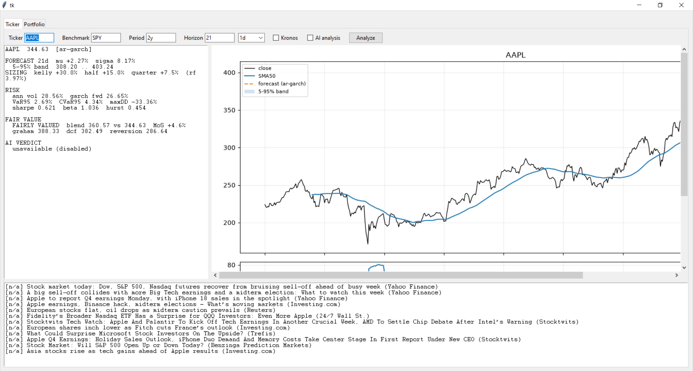
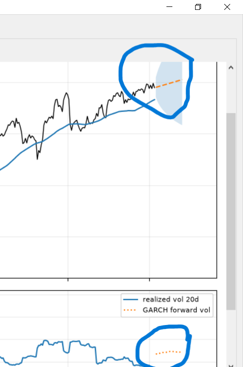
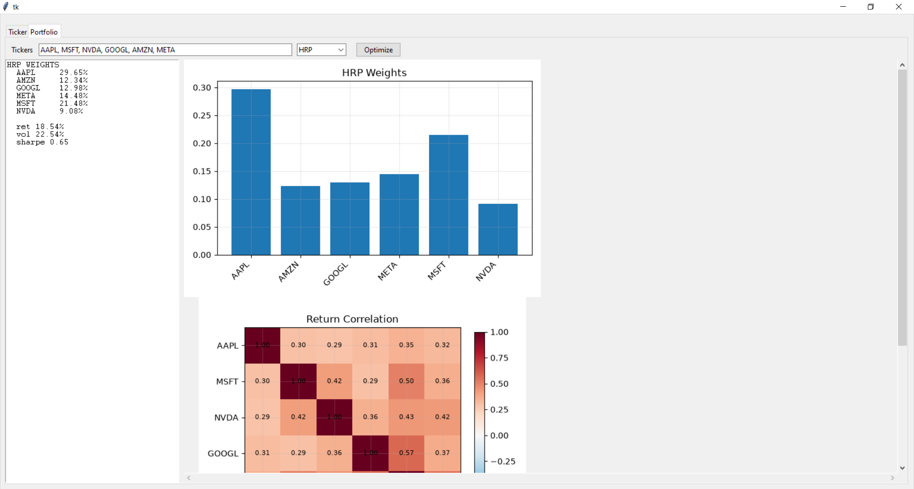
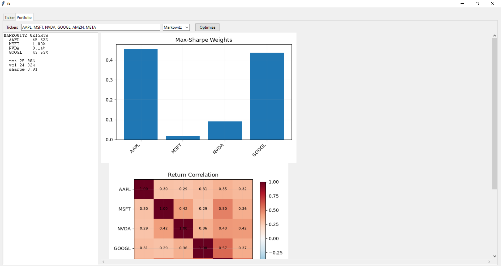

# Quant Analysis terminal

Single-file Python desktop tool for single-stock risk analysis, volatility-based forecasting, fair-value estimation and hierarchical-risk-parity portfolio construction bundled into 1 single application. Data from Yahoo Finance via `yfinance` with optional Gemini-powered news sentiment and AI verdict.

> **Not financial advice.** Research/educational tool. Models are NOT BACKTESTED, forecasts have no demonstrated predictive edge, and Yahoo data can be wrong or delayed. Do not trade real money on its output.

## Features

**Ticker tab**
- **Risk:** annualized volatility, Sharpe, max drawdown, historical VaR/CVaR (95%), CAPM beta vs. a benchmark, Hurst exponent
- **Forecast:** AR(p)-EGARCH(1,1,1) with Student-t errors (AR order picked by BIC). Gives an expected path, a 5-95% band and forward volatility. Optional [Kronos](https://github.com/shiyu-coder/Kronos) forecaster (off and base model by default)
- **Sizing:** Kelly fraction over the forecast horizon, `(mean + σ²/2 − risk-free) / σ²`, shown at full/half/quarter and capped at ±30%. The risk-free rate is the latest 13-week T-bill yield (`^IRX`)
- **Fair value:** blend of Graham formula (35%), two-stage earnings DCF (40%), and P/E reversion (25%), plus a reverse-DCF implied growth rate
- **News + AI (optional):** Gemini scores headline sentiment and produces a structured buy/hold/avoid verdict

**Portfolio tab**
- Choose **HRP** (Hierarchical Risk Parity) or **Markowitz** (long-only maximum Sharpe, Ledoit-Wolf covariance) from the dropdown. Features a weight chart and return-correlation heatmap for both. A more robust approch would be combining both by using Markowitz for the screening the top allocated stocks and passing them to HRP to adjust for risk.

## Screenshots
|Ticker Tab|

|Price, forecast band and volatility|


| Hierarchical Risk Parity | Markowitz(Ledoit-Wolf method) maximum Sharpe |
|---|---|
|  |  |

## Install

Python 3.11+ and Tkinter are required 

```bash
git clone https://github.com/Hanif-Wong/quant-analysis-terminal.git
cd quant-analysis-terminal
python -m venv .venv
# Windows: .venv\Scripts\activate    |   macOS/Linux: source .venv/bin/activate
pip install -r requirements.txt
```

## Run

```bash
python tool.py
```

### Gemini (optional)
Without a key, everything works except news sentiment and the AI verdict. Get a key from [Google AI Studio](https://aistudio.google.com/) and set it before launching:

```powershell
# PowerShell
$env:GEMINI_API_KEY="your-key"
```
```bash
# macOS/Linux
export GEMINI_API_KEY="your-key"
```

Ticker data, headlines and article excerpts are sent to Google when "AI analysis" is ticked. The model is set by `GEMINI_MODEL` at the top of `tool.py`.

### Kronos (optional)
Not pip-installable. Clone the Kronos repo, install its requirements (including `torch`), then:

```bash
export KRONOS_DIR=/path/to/Kronos      # PowerShell: $env:KRONOS_DIR="C:\path\to\Kronos"
```
Tick **Kronos** in the UI. If it fails to load, the tool falls back to AR-GARCH and prints the reason to stderr.

## Configuration

Edit the constants at the top of `tool.py`, and keep them current:

| Constant | Meaning |
|---|---|
| `RISK_FREE_RATE` | Annual risk-free rate, replaced at runtime by the latest `^IRX` yield when Yahoo Finance is reachable |
| `AAA_YIELD_PCT` | AAA corporate bond yield (%) used in the Graham formula |
| `MARKET_PREMIUM` | Equity risk premium for cost of equity |
| `GEMINI_MODEL` | Gemini model ID (defaulted to gemini-3.5-flash-lite)|

## Notes and limitations

- **Intervals:** Yahoo limits intraday history (1m ≈ 7 days, other intraday ≈ 60 days). Use a short period (e.g. `5d`, `1mo`) for intraday intervals. Fair value and beta are only meaningful on `1d` or slower.
- **Fair value** uses Yahoo's latest-quarter earnings growth, which is sometimes inaccurate.
- **Kelly sizing** is only as good as the forecast mean, which is close to zero and noisy for AR-GARCH. It's advised to use the quater-Kelly.
- **Markowitz max-Sharpe** on historical means is unstable and tends to concentrate in a few names; it errors if no asset beats the risk-free rate. HRP is the more robust option for out of sample performance.
- **SciPy is pinned to 1.17.1** because PyPortfolioOpt's HRP reads a private SciPy name that other versions may not provide.
- **Data:** `yfinance` is an unofficial scraper of Yahoo Finance; check Yahoo's terms for your use case.
- Tested on Windows 10. Mouse-wheel scrolling in the chart pane is Windows-only.

## License
This project is licensed under the MIT License
